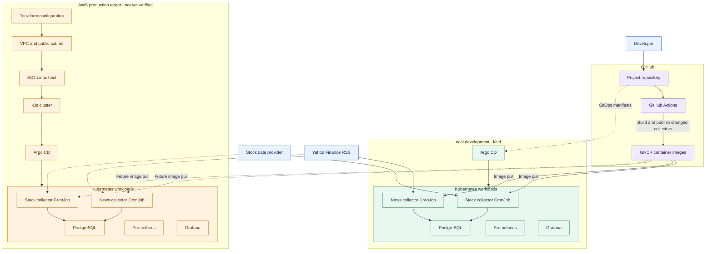

# Event Intelligence Platform

A personal DevOps project for collecting stock prices and related news on a schedule, storing the results in PostgreSQL, and operating the workloads on Kubernetes. Stock data is the main scope; this project does not provide investment advice or place trades.

## Architecture

The AWS box shows the declared production target, not a completed deployment. Dashed arrows mark target or external connections.

## Project status

- The repository contains Python stock and news collectors, container build definitions, Kubernetes manifests, and Helm configuration for PostgreSQL and monitoring components.
- GitHub Actions is configured for path-based validation and collector image publishing to GHCR.
- Local kind is the development target. AWS EC2/k3s is described as a target, not a completed deployment.
- The Terraform files are still being prepared. See [Terraform notes](terraform/README.md) for the resources and current configuration limits.
- Grafana dashboard and alert work is not presented here as complete.

## Storage and cost

The Terraform configuration declares an encrypted 2 GiB EBS volume for PostgreSQL. The S3 bucket is for Terraform state and serves a separate purpose. Review the Terraform plan and AWS charges before applying resources.

## Project notes

- [Project blueprint](docs/PROJECT_BLUEPRINT.md)
- [MVP specification](docs/MVP_SPEC.md)
- [Implementation plan](docs/IMPLEMENTATION_PLAN.md)
- [AWS setup checklist](docs/AWS_CONNECTIONS.md)
- [Terraform notes](terraform/README.md)

