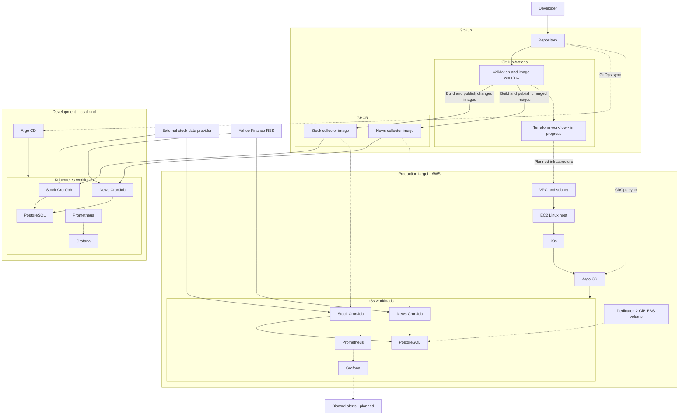

# Event Intelligence Platform

A personal DevOps project for collecting stock market data on a schedule and storing it in PostgreSQL. Stock prices are the primary scope; related news is a second collector. The project focuses on packaging, deploying, and operating scheduled workloads. It does not provide investment advice or place trades.

## Architecture

Each environment has its own Argo CD: local Argo CD manages development workloads in kind; the planned AWS Argo CD will manage production workloads in k3s.

## Current status

- Stock and news collector code, Dockerfiles, PostgreSQL schema, CronJob manifests, and Helm application definitions are present.
- The Argo CD root and child Application manifests point to this repository.
- GitHub Actions contains path-based validation and image build/publish workflows. The manual OIDC identity check succeeded; it did not provision AWS resources.
- Terraform is now split into `terraform/bootstrap` and `terraform/infra`. The configurations and their GitHub workflow connection still need fixes before a reliable AWS deployment.
- Ansible is intended to install k3s and bootstrap Argo CD. The EC2 address and access method (SSH key or SSM) are not yet wired through the workflow.
- The PostgreSQL chart uses a local-path StorageClass. Connecting its data to the planned EC2 EBS volume remains unfinished.
- Custom Grafana dashboards and Discord alert rules are not yet in the repository.

The repository describes the intended local kind and AWS EC2/k3s environments. It does not yet provide evidence that the end-to-end deployment has completed. See the [Terraform and deployment notes](terraform/README.md) for the current blockers.

## DevOps focus

The project applies CI, container image delivery, GitOps, infrastructure as code, persistent storage, and monitoring to scheduled data collection. The Python collectors are intentionally small so the focus stays on delivering and operating the platform.

## Storage and cost

The production target is a dedicated 2 GiB EBS volume for PostgreSQL. The Terraform state bucket is a separate purpose: it stores Terraform's state file. The Kubernetes PVC, EBS volume, and S3 state bucket are not interchangeable.

AWS resources such as EC2, EBS, public networking, and CloudTrail may incur charges. Review the plan and expected cost before applying it.

## Project notes

- [Project blueprint](docs/PROJECT_BLUEPRINT.md)
- [MVP specification](docs/MVP_SPEC.md)
- [Implementation plan](docs/IMPLEMENTATION_PLAN.md)
- [AWS setup checklist](docs/AWS_CONNECTIONS.md)
- [Terraform and deployment notes](terraform/README.md)
