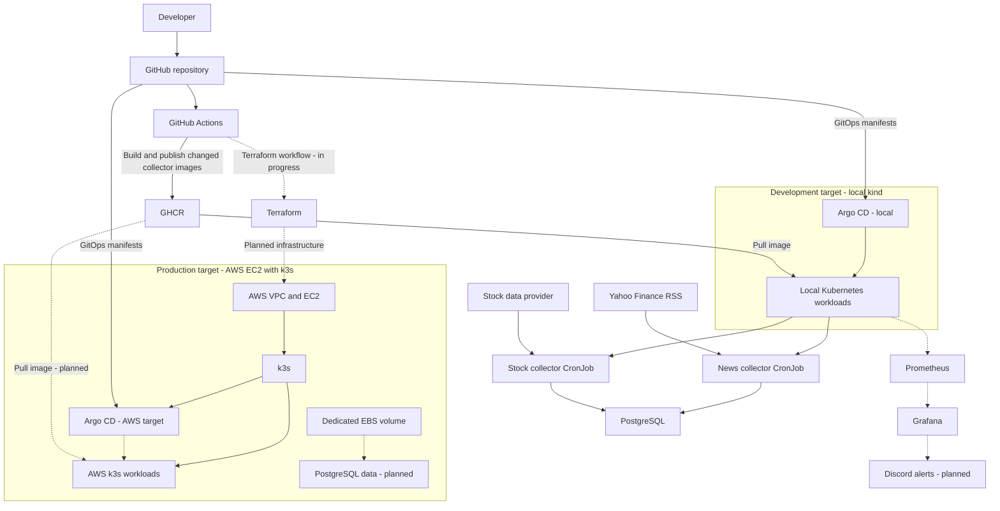

# Event Intelligence Platform

A personal DevOps project for collecting stock market data on a schedule and storing it in PostgreSQL. Stock prices are the primary scope; related news is a second collector. The project focuses on how to package, deploy, and operate these scheduled workloads. It does not provide investment advice or place trades.

## Architecture

## Current status

- Python stock and news collectors, Dockerfiles, Kubernetes CronJobs, and PostgreSQL schema are present.
- Argo CD root and child Application manifests are configured to track this repository.
- Helm charts are configured for PostgreSQL, Prometheus, and Grafana. PostgreSQL currently references a `local-path` StorageClass; AWS EBS-backed Kubernetes storage is not connected yet.
- GitHub Actions defines path-based validation and collector image build/publish workflows. The manual OIDC identity check has been run; this does not mean Terraform has provisioned AWS resources.
- Terraform and Ansible are in progress. AWS infrastructure has not been provisioned, and the Terraform configuration still needs validation before use.
- Custom Grafana dashboards and Discord alert rules are not yet included in the repository.

The local kind cluster is the development environment and has its own Argo CD instance to deploy the development workloads. The planned AWS EC2/k3s production cluster will have a separate Argo CD instance for production workloads. Each Argo CD watches this Git repository and applies its environment manifests to its own cluster. The AWS environment is not deployed yet; describe either environment as verified only after a successful run.

## DevOps focus

The project applies CI, container image delivery, GitOps, infrastructure as code, persistent storage, and monitoring to scheduled data collection. The Python collectors are intentionally small so the main focus stays on delivering and operating the platform.

## Storage and cost

The production target is a dedicated 2 GiB EBS volume for PostgreSQL. Terraform state is intended for a separate S3 bucket. The EBS volume stores database files; the S3 bucket stores Terraform state.

No AWS infrastructure is currently deployed. EC2, EBS, networking, and logging services may incur charges. Review the Terraform plan and expected cost before applying it.

## Project notes

- [Project blueprint](docs/PROJECT_BLUEPRINT.md)
- [MVP specification](docs/MVP_SPEC.md)
- [Implementation plan](docs/IMPLEMENTATION_PLAN.md)
- [AWS setup checklist](docs/AWS_CONNECTIONS.md)
- [Terraform notes](terraform/README.md)

