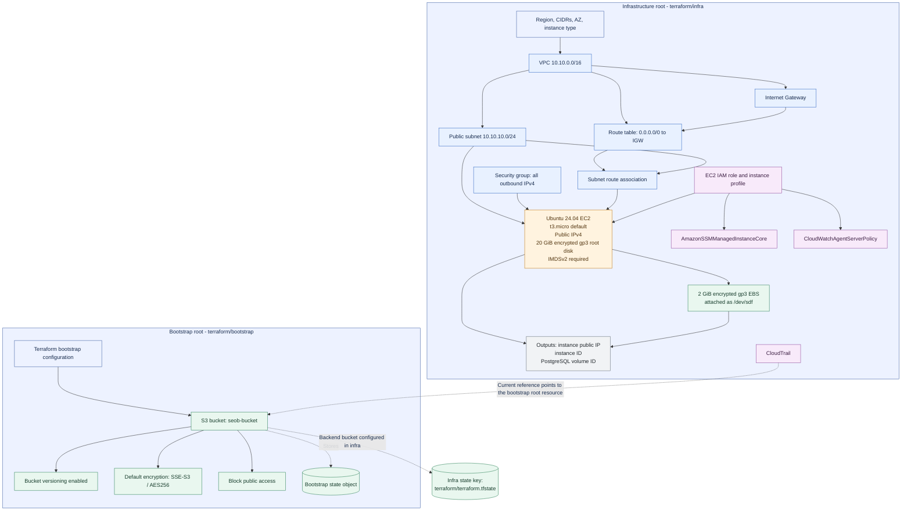

# Terraform Infrastructure

This document covers only the Terraform roots and AWS resources declared under `terraform/`. The diagrams show configuration intent; they do not mean the AWS resources have been applied or verified.

## Terraform layout

## Declared resources

### `terraform/bootstrap`

- Creates the `seob-bucket` S3 bucket.
- Enables bucket versioning, AES256 server-side encryption, and S3 Block Public Access.
- Declares an S3 backend for bootstrap state.

### `terraform/infra`

- Creates a VPC, one public subnet, an Internet Gateway, a default internet route, and a route-table association.
- Creates an EC2 security group with unrestricted outbound IPv4 and no inbound rules declared in this Terraform configuration.
- Creates an Ubuntu 24.04 EC2 instance with a public IPv4 address, a 20 GiB encrypted gp3 root disk, and IMDSv2 required.
- Creates an EC2 role/profile with `AmazonSSMManagedInstanceCore` and `CloudWatchAgentServerPolicy` attached.
- Creates an encrypted 2 GiB gp3 EBS volume and attaches it to EC2 as `/dev/sdf`.
- Declares outputs for the instance public IP, instance ID, and EBS volume ID.
- Declares a CloudTrail resource.

## State layout

Both roots are configured to use `seob-bucket`, with different state keys intended to keep their state separate:

- `infra`: `terraform/terraform.tfstate`
- `bootstrap`: the current `terraform/bootstrap/terraform.tf` contains two backend declarations with different keys. Resolve that duplicate before using the configuration.

The S3 backend stores Terraform state; it does not create its own bucket. The bucket resource is declared in the bootstrap root.

## Current configuration limits

- The bootstrap `.tf` files currently contain duplicated resource/backend blocks and `---` separator lines. As written, they need cleanup before Terraform can validate or run.
- The CloudTrail configuration in `terraform/infra/compute.tf` refers to `aws_s3_bucket.seob_s3`, which is declared in a different Terraform root. Terraform roots do not share resource addresses directly. The current CloudTrail bucket reference is therefore not a valid cross-root connection.
- Terraform only attaches the EBS volume. The current Terraform files do not format or mount it, nor connect it to a Kubernetes PVC.
- The diagrams describe declared Terraform configuration only. No Terraform validation, plan, or AWS apply was run while updating this README.

